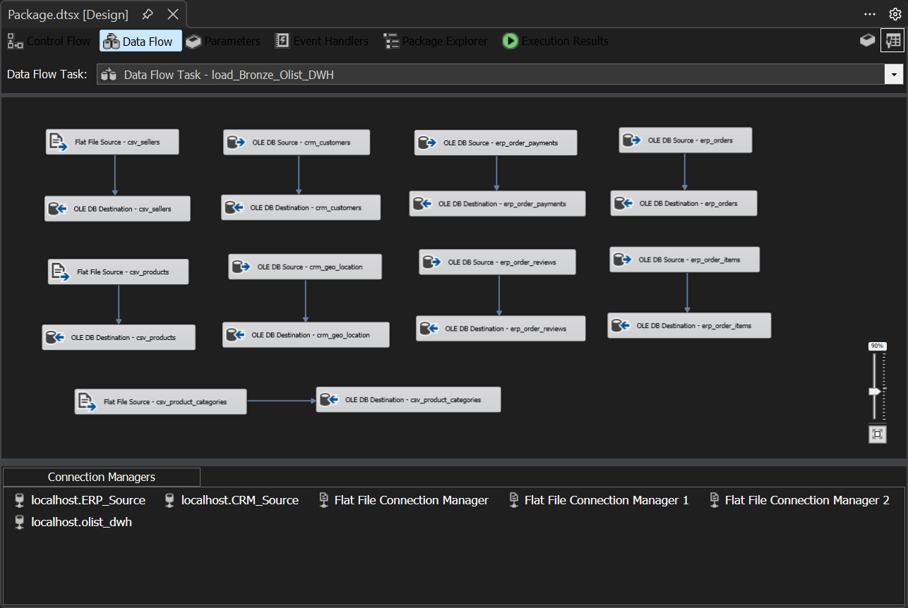
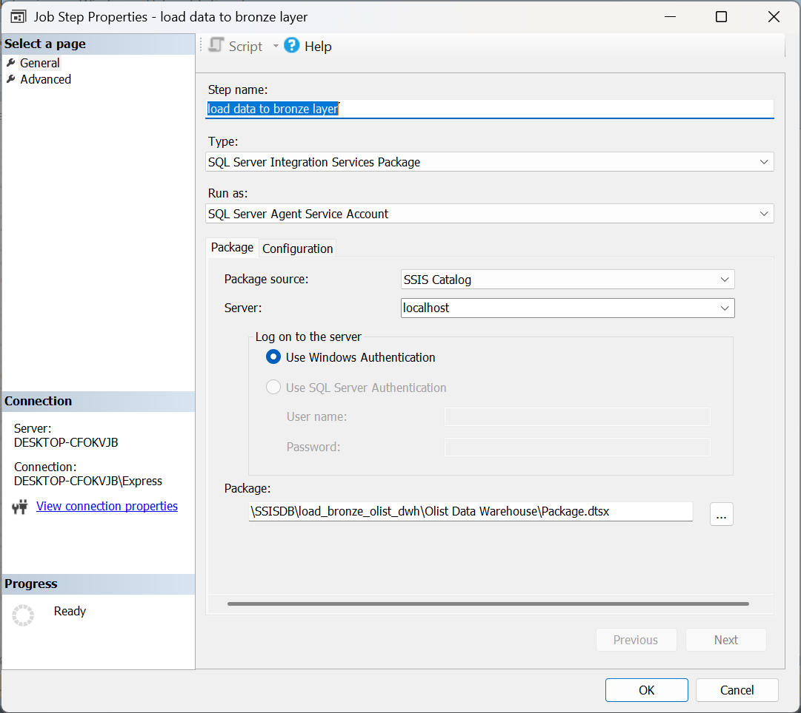
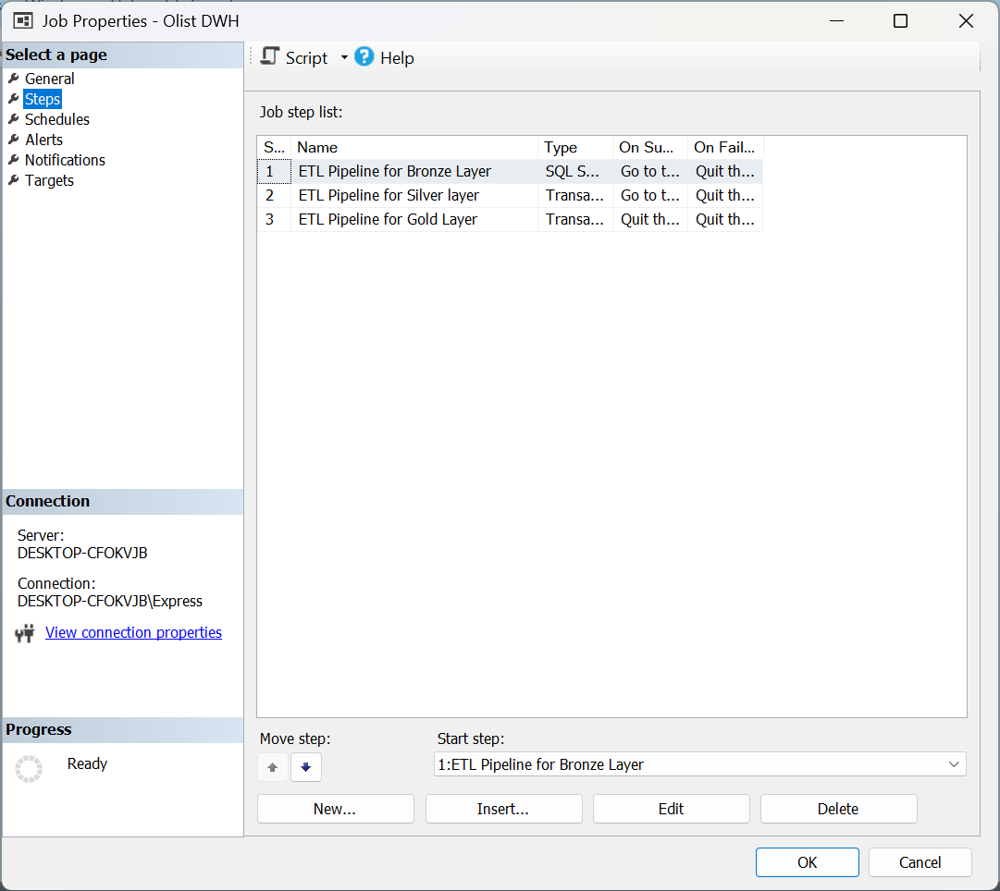
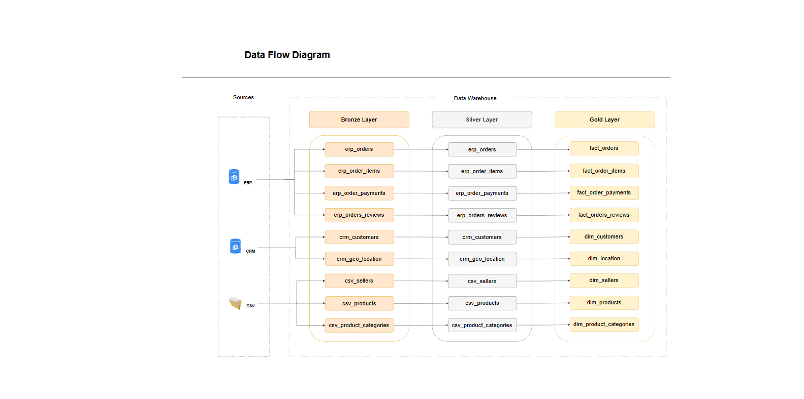
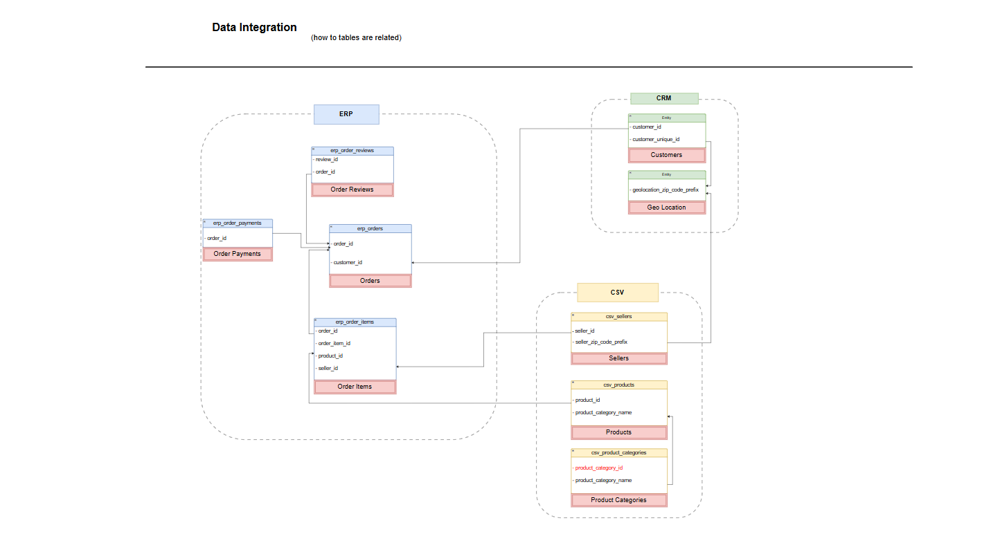
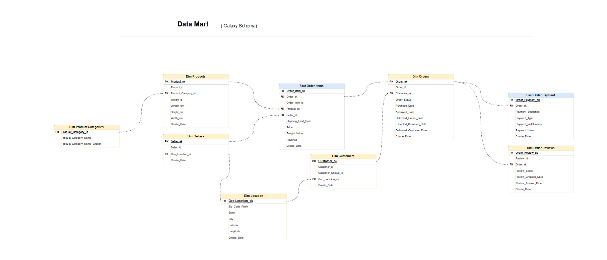

# Olist E-Commerce Data Warehouse & Analytics

An end-to-end data warehousing and analytics project built using Microsoft SQL Server, SSIS, T-SQL, and Power BI technologies. The project transforms raw e-commerce data into a structured analytical data warehouse to support business analysis and data-driven decision-making.

## 📌 Project Overview

This project uses the Brazilian Olist e-commerce dataset to build an analytical data warehouse that integrates data from multiple source systems, applies data cleaning and transformation processes, and organizes the resulting data into a dimensional model for business intelligence and reporting.

The primary objective is to transform raw operational data into reliable, structured, and analysis-ready datasets that help stakeholders understand sales performance, customer behavior, payment patterns, product performance, and delivery operations.

## 🎯 Business Objectives

* Analyze sales performance and revenue trends over time.
* Understand customer purchasing behavior and geographic distribution.
* Evaluate product and seller performance.
* Analyze payment methods and payment distribution.
* Investigate delivery performance and its relationship with customer satisfaction.
* Identify data quality issues and source-data inconsistencies.
* Build a reliable data foundation for business intelligence and reporting.

## 🛠️ Technologies Used

| Technology                             | Purpose                                                            |
| -------------------------------------- | ------------------------------------------------------------------ |
| Microsoft SQL Server                   | Data storage, data warehousing, and analytical queries             |
| SQL Server Integration Services (SSIS) | ETL orchestration and data movement                                |
| T-SQL                                  | Data transformation, cleansing, validation, and analytical queries |
| SQL Server Agent                       | Scheduling and execution of ETL jobs                               |
| Power BI                               | Business intelligence and data visualization                       |
| Excel / CSV                            | Supporting data sources and validation                             |

## 🏗️ Data Warehouse Architecture

The project follows a layered data warehouse architecture:

**Source Systems → Bronze Layer → Silver Layer → Gold Layer → Business Analytics**

### 1. Source Systems

Data is collected from multiple source databases and supplementary CSV files.

The source data covers key e-commerce entities, including:

* Customers
* Orders
* Order Items
* Payments
* Reviews
* Products
* Sellers
* Product Categories
* Geographic Locations

### 2. Bronze Layer

The Bronze Layer stores the ingested source data in the data warehouse environment.

Its primary purpose is to establish a centralized landing layer for the source data before applying downstream transformations.

### 3. Silver Layer

The Silver Layer applies data cleansing and transformation logic using T-SQL.

Key activities include:

* Data type standardization.
* Handling duplicate records.
* Data quality checks.
* Transformation and preparation of source entities.
* Validation of data before loading the Gold Layer.

### 4. Gold Layer

The Gold Layer contains the business-oriented dimensional model used for analytical queries and reporting.

The model includes dimension tables and fact tables designed to support different business analysis scenarios.

**Dimension tables:**

* `dim_customers`
* `dim_geo_location`
* `dim_orders`
* `dim_order_reviews`
* `dim_products`
* `dim_product_categories`
* `dim_sellers`

**Fact tables:**

* `fact_order_items`
* `fact_order_payments`

The model supports analysis across customer, order, product, seller, geographic, payment, and review dimensions.

## 🔄 ETL Pipeline

The ETL process is organized into three major stages:

1. **Extract and Load:** Ingest source data into the Bronze Layer using SSIS.
2. **Transform:** Clean, validate, and transform data in the Silver Layer using T-SQL.
3. **Load and Prepare:** Populate the Gold Layer using SQL transformation logic and stored procedures.

SQL Server Agent is used to execute the scheduled ETL workflow.

The pipeline separates data ingestion from transformation and analytical modeling, making the process easier to maintain, validate, and troubleshoot.

## 📊 Data Validation & Quality Assurance

Data quality validation is an important part of this project.

The validation process includes comparing source, Bronze, Silver, and Gold record counts to identify discrepancies and ensure that data transformations behave as expected.

Additional checks investigate:

* Missing records between orders, order items, and payments.
* Duplicate records in source entities.
* Missing delivery timestamps.
* Missing product category information.
* Incomplete customer geographic mappings.
* Unusual product return patterns.
* Differences between item-level revenue and payment-level values.

These checks help distinguish ETL-related issues from inconsistencies already present in the source data.

Where source entities do not align perfectly, the findings are documented so that analytical limitations can be understood rather than silently ignored.

## 📈 Business Analysis

The project includes SQL-based business analysis covering several key areas.

### Sales & Revenue Analysis

* Revenue trends over time.
* Order volume and average order value.
* Revenue distribution across geographic regions.
* Comparison of order item values and payment values.

### Customer Analysis

* Customer distribution by state.
* Customer purchasing activity.
* Geographic analysis of customer demand.

### Product & Seller Analysis

* Product performance.
* Seller contribution to e-commerce activity.
* Product category analysis.

### Payment Analysis

* Payment method distribution.
* Payment values across different methods.
* Reconciliation between payments and order items.

### Delivery & Customer Satisfaction

* Delivery duration analysis.
* Late versus on-time delivery performance.
* Review score comparisons by delivery performance.

## 🔍 Selected Business Insights

The analysis identified several notable findings:

* **Geographic concentration:** São Paulo, Rio de Janeiro, and Minas Gerais account for approximately 66.5% of the analyzed revenue, highlighting the importance of Brazil's southeastern market.
* **Payment preferences:** Credit cards represent the largest payment method by both transaction count and total payment value.
* **Customer satisfaction:** Orders delivered earlier than expected received substantially higher average review scores than orders delivered on time or late.
* **Delivery performance:** Late deliveries are associated with lower average customer review scores, indicating a potential relationship between delivery experience and customer satisfaction.
* **Data reconciliation:** Some orders have payment records but no corresponding order-item records, requiring careful interpretation of financial and product-level metrics.
* **Source data quality:** Missing values and inconsistencies were investigated across multiple layers to improve transparency and analytical reliability.

These findings illustrate how data warehousing and SQL analysis can convert operational data into actionable business information.

## 📁 Repository Structure

The repository contains the SQL scripts and supporting screenshots used to document the data warehouse implementation and analytical work.

A suggested structure is:

```text
Olist-Data-Warehouse/
│
├── README.md
│
├── scripts/
│   ├── Bronze/
│   ├── Silver/
│   ├── Gold/
│   └── Data_Quality/
│
├── screenshots/
│   ├── Architecture/
│   ├── ETL/
│   ├── Data_Model/
│   └── Business_Insights/
│
└── ...
```

*The directory names above are illustrative. Refer to the actual repository structure for the exact locations of the project files.*

## Dashboard Preview
### Data Flow in SSIS


### Bronze Layer Job


### ETL Pipelines Steps


### Data Flow Diagram


### Data Integration


### Data Model



## 🚀 How to Explore the Project

1. Review the SQL scripts to understand the data ingestion and transformation logic.
2. Explore the Bronze, Silver, and Gold layers to follow the data flow.
3. Examine the dimensional model and the relationships between fact and dimension tables.
4. Review the data quality validation scripts to understand how inconsistencies were investigated.
5. Explore the business analysis queries to see how SQL was used to answer business questions.
6. Review the screenshots for implementation evidence and analytical results.

## 💡 Key Skills Demonstrated

* Data Warehousing
* ETL Development
* SQL Server Integration Services (SSIS)
* Advanced T-SQL
* Dimensional Modeling
* Fact and Dimension Table Design
* Data Cleaning and Transformation
* Data Quality Validation
* SQL-Based Business Analysis
* Data Reconciliation
* Business Intelligence
* Analytical Problem-Solving

## 📚 Dataset

This project is based on the Brazilian E-Commerce Public Dataset by Olist, which contains information about e-commerce orders, customers, sellers, products, payments, and reviews.

The dataset is available through the [Olist Brazilian E-Commerce dataset on Kaggle](https://www.kaggle.com/datasets/olistbr/brazilian-ecommerce).

Please refer to the original dataset documentation and licensing terms before redistributing the source data.

## 👤 Author

**Ahmed Elsayad**

Data Analutics Engineering | BI Developer

Interested in building reliable data pipelines, designing analytical data models, and transforming raw data into meaningful business insights.

* GitHub: [Add your GitHub profile link here.](https://github.com/Ahmed-Elsayad99)
* LinkedIn: linkedin.com/in/ahmed-elsayad-620912359.

---

*This project was developed for educational and portfolio purposes to demonstrate practical data warehousing, ETL, SQL analytics, and data quality validation skills.*
