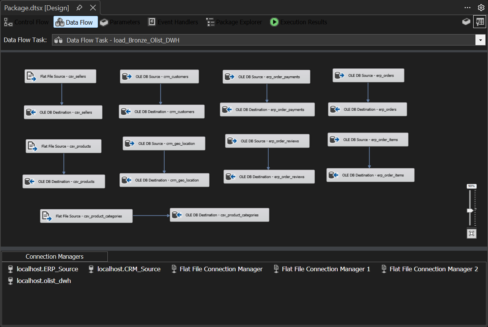
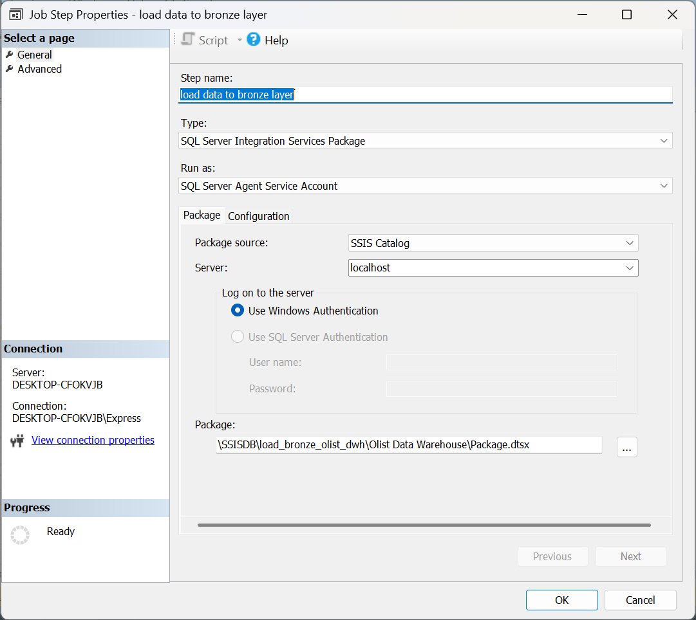
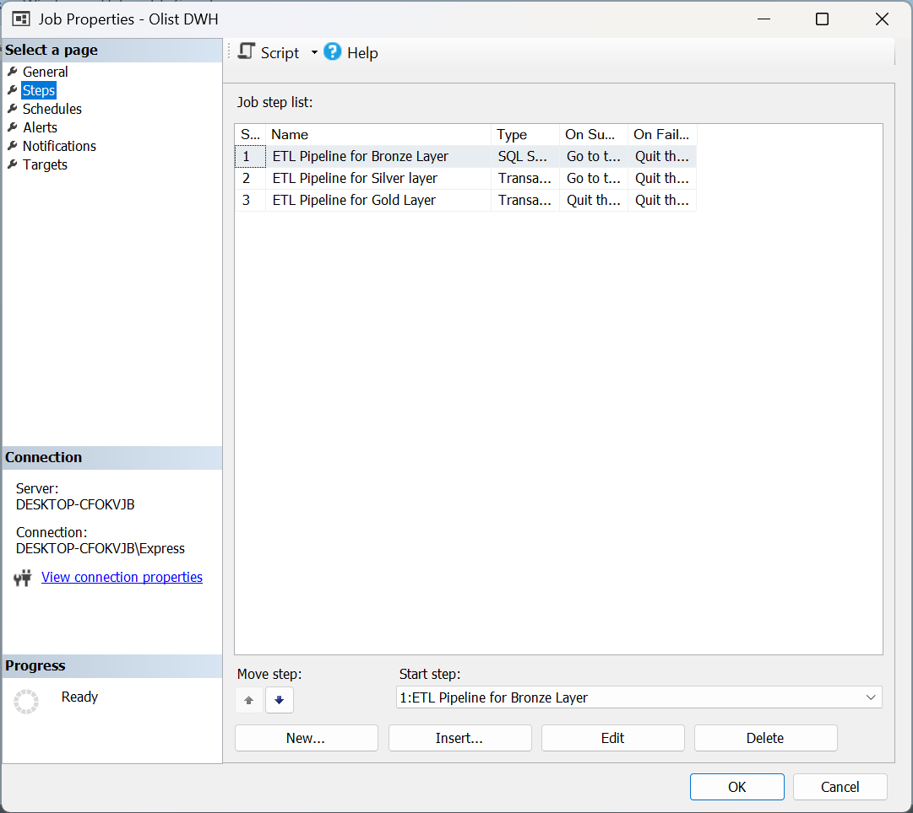
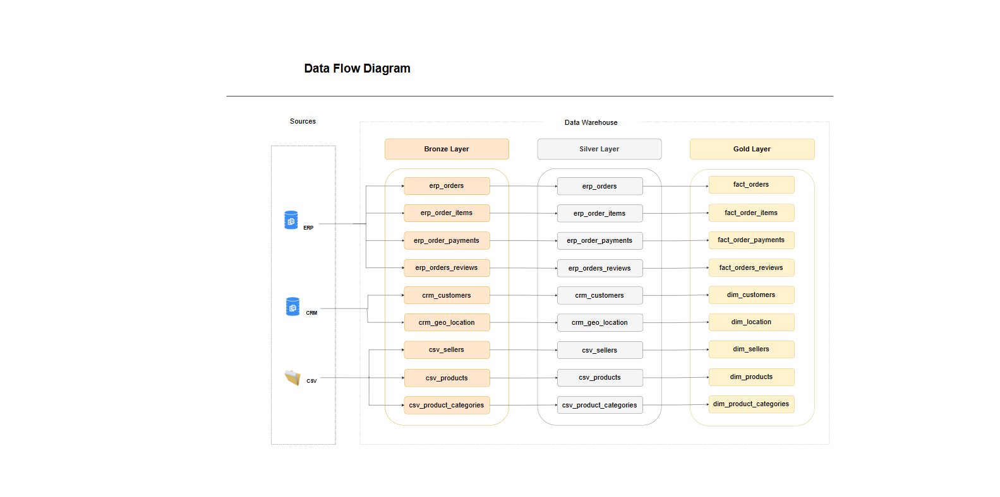
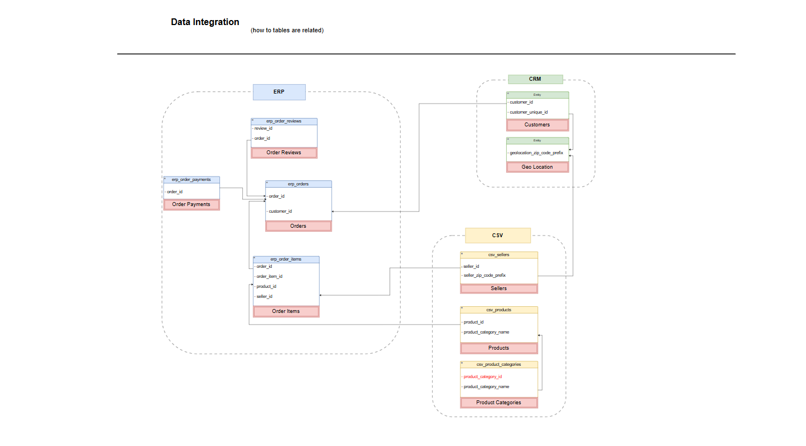
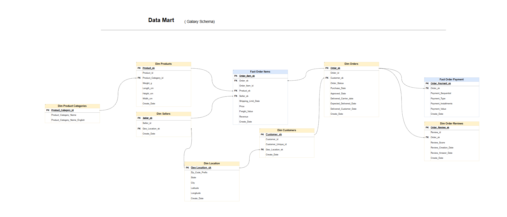

# Olist E-Commerce Data Warehouse & Analytics


An end-to-end data warehousing and analytics project built using Microsoft SQL Server, SSIS, T-SQL, and Power BI technologies. The project transforms raw e-commerce data into a structured analytical data warehouse to support business analysis and data-driven decision-making.

## 📌 Project Overview

This project uses the Brazilian Olist e-commerce dataset to build an analytical data warehouse that integrates data from multiple source systems, applies data cleaning and transformation processes, and organizes the resulting data into a dimensional model for business intelligence and reporting.

The primary objective is to transform raw operational data into reliable, structured, and analysis-ready datasets that help stakeholders understand sales performance, customer behavior, payment patterns, product performance, and delivery operations.

## 🎯 Business Objectives

* Analyze sales performance and revenue trends over time.
* Understand customer purchasing behavior and geographic distribution.
* Evaluate product and seller performance.
* Analyze payment methods and payment distribution.
* Investigate delivery performance and its relationship with customer satisfaction.
* Identify data quality issues and source-data inconsistencies.
* Build a reliable data foundation for business intelligence and reporting.

## 🛠️ Technologies Used

| Technology                             | Purpose                                                            |
| -------------------------------------- | ------------------------------------------------------------------ |
| Microsoft SQL Server                   | Data storage, data warehousing, and analytical queries             |
| SQL Server Integration Services (SSIS) | ETL orchestration and data movement                                |
| T-SQL                                  | Data transformation, cleansing, validation, and analytical queries |
| SQL Server Agent                       | Scheduling and execution of ETL jobs                               |
| Power BI                               | Business intelligence and data visualization                       |
| Excel / CSV                            | Supporting data sources and validation                             |

## 🏗️ Data Warehouse Architecture

The project follows a layered data warehouse architecture:

**Source Systems → Bronze Layer → Silver Layer → Gold Layer → Business Analytics**

### 1. Source Systems

Data is collected from multiple source databases and supplementary CSV files.

The source data covers key e-commerce entities, including:

* Customers
* Orders
* Order Items
* Payments
* Reviews
* Products
* Sellers
* Product Categories
* Geographic Locations

### 2. Bronze Layer

The Bronze Layer stores the ingested source data in the data warehouse environment.

Its primary purpose is to establish a centralized landing layer for the source data before applying downstream transformations.

### 3. Silver Layer

The Silver Layer applies data cleansing and transformation logic using T-SQL.

Key activities include:

* Data type standardization.
* Handling duplicate records.
* Data quality checks.
* Transformation and preparation of source entities.
* Validation of data before loading the Gold Layer.

### 4. Gold Layer

The Gold Layer contains the business-oriented dimensional model used for analytical queries and reporting.

The model includes dimension tables and fact tables designed to support different business analysis scenarios.

**Dimension tables:**

* `dim_customers`
* `dim_geo_location`
* `dim_orders`
* `dim_order_reviews`
* `dim_products`
* `dim_product_categories`
* `dim_sellers`

**Fact tables:**

* `fact_order_items`
* `fact_order_payments`

The model supports analysis across customer, order, product, seller, geographic, payment, and review dimensions.

## 🔄 ETL Pipeline & Data Transformation

The ETL process is organized into three major stages, orchestrated seamlessly using SSIS, T-SQL, and SQL Server Agent:

1. **Extract and Load (Bronze Layer):** Ingest raw source data (CSV and transactional databases) into the Bronze Layer using SSIS packages with minimal transformation to preserve raw data integrity.
2. **Transform & Cleanse (Silver Layer):** Execute robust T-SQL stored procedures (`silver.load_silver`) to clean, standardize, and transform raw data. Key operations include:
   - **Data Normalization & Cleaning:** Trimming whitespace, removing rogue quotes (`"`), standardizing text to UPPERCASE, and mapping inconsistent state abbreviations to full names.
   - **Date & Sequence Validation:** Handling complex overlapping order timestamps and establishing logical chronological order for purchases, approvals, and deliveries.
   - **Duplicate Elimination:** Using Window Functions (`ROW_NUMBER()` with `PARTITION BY`) to filter out duplicate records (e.g., in customer reviews and orders).
3. **Load and Prepare (Gold Layer):** Populate the business-oriented dimensional model (Fact and Dimension tables) to support analytical queries and reporting.

SQL Server Agent automates and schedules the entire workflow, ensuring clean separation between ingestion, transformation, and modeling.

---

## 💻 Featured ETL Transformation Script (Silver Layer)

Below is an excerpt from the stored procedure demonstrating data cleaning, chronological date validation, and duplicate removal using T-SQL:

```sql
-- Example: Handling Order Timestamps Logic & Removing Duplicates in Reviews
WITH cleaned_a AS (
    SELECT 
        UPPER(REPLACE(TRIM(order_id), '"','')) as order_id,
        UPPER(REPLACE(TRIM(customer_id), '"','')) as customer_id,
        UPPER(TRIM(order_status)) as order_status,
        -- Complex timestamp cleaning and sequencing logic...
        order_purchase_timestamp,
        order_approved_at,
        order_delivered_carrier_date,
        order_delivered_customer_date,
        order_estimated_delivery_date
    FROM olist_dwh.bronze.erp_Orders
)
-- Removing Duplicates using Window Functions in Reviews
INSERT INTO olist_dwh.silver.erp_order_reviews (...)
SELECT review_id, order_id, review_score, ...
FROM (
    SELECT 
        UPPER(REPLACE(TRIM(review_id), '"', '')) AS review_id,
        UPPER(REPLACE(TRIM(order_id), '"', '')) AS order_id,
        review_score,
        COALESCE(review_comment_message, 'n/a') AS review_comment_message,
        ROW_NUMBER() OVER (
            PARTITION BY UPPER(REPLACE(TRIM(order_id), '"', '')) 
            ORDER BY review_creation_date DESC, review_id
        ) AS rn
    FROM olist_dwh.bronze.erp_order_reviews
) AS ranked_reviews
WHERE rn = 1;
```

## 📊 Data Validation & Quality Assurance

Data quality validation is an essential pillar of this project, ensuring that analytical results remain reliable, consistent, and trustworthy across all pipeline layers.

* **Record Count Reconciliation:** Systematically comparing record counts across Source, Bronze, Silver, and Gold layers to ensure zero unintentional data loss during ETL operations.
* **Integrity & Consistency Validation:**
  - Investigating structural gaps and missing relationships between orders, order items, and payment entities.
  - Resolving null delivery timestamps, unmapped product categories, and incomplete customer geolocation prefixes.
  - Reconciling item-level revenue against aggregate payment values to identify pricing and transaction discrepancies.
  - Detecting and deduplicating raw source records using advanced window functions.
* **Source-Level Anomaly Documentation:** Documenting inherent source data anomalies (such as orders with payments but missing item records) rather than silently dropping them, ensuring complete transparency for downstream analytics.

## 📈 Business Analysis

The project includes SQL-based business analysis covering several key areas.

### Sales & Revenue Analysis

* Revenue trends over time.
* Order volume and average order value.
* Revenue distribution across geographic regions.
* Comparison of order item values and payment values.

### Customer Analysis

* Customer distribution by state.
* Customer purchasing activity.
* Geographic analysis of customer demand.

### Product & Seller Analysis

* Product performance.
* Seller contribution to e-commerce activity.
* Product category analysis.

### Payment Analysis

* Payment method distribution.
* Payment values across different methods.
* Reconciliation between payments and order items.

### Delivery & Customer Satisfaction

* Delivery duration analysis.
* Late versus on-time delivery performance.
* Review score comparisons by delivery performance.

## 🔍 Selected Business Insights

The analysis identified several notable findings:

* **Geographic concentration:** São Paulo, Rio de Janeiro, and Minas Gerais account for approximately 66.5% of the analyzed revenue, highlighting the importance of Brazil's southeastern market.
* **Payment preferences:** Credit cards represent the largest payment method by both transaction count and total payment value.
* **Customer satisfaction:** Orders delivered earlier than expected received substantially higher average review scores than orders delivered on time or late.
* **Delivery performance:** Late deliveries are associated with lower average customer review scores, indicating a potential relationship between delivery experience and customer satisfaction.
* **Data reconciliation:** Some orders have payment records but no corresponding order-item records, requiring careful interpretation of financial and product-level metrics.
* **Source data quality:** Missing values and inconsistencies were investigated across multiple layers to improve transparency and analytical reliability.

These findings illustrate how data warehousing and SQL analysis can convert operational data into actionable business information.

## 📁 Repository Structure

The repository contains the SQL scripts, documentation diagrams, analytical queries, and presentation assets structure as follow:


```text
Olist-Data-Warehouse/
│
├── README.md
├── Presentation/
│
├── DWH_Scripts/
│   ├── Bronze/
│   ├── Silver/
│   └── Gold/
│
├── Docs/
│   ├── Data Flow in SSIS/
│   ├── ETL Steps in Job/
│   ├── Data flow Diagram/
│   ├── Data Integration Diagram/
│   └── Data Model (Galaxy Schema)/
│
└── SQL-Analytics/
    ├── EDA/
    └── Advanced Analytics/

```

*The directory names above are illustrative. Refer to the actual repository structure for the exact locations of the project files.*

## Docs
### Data Flow in SSIS


### Bronze Layer Job


### ETL Pipelines Steps


### Data Flow Diagram


### Data Integration


### Data Model



## 🚀 How to Explore the Project

1. Review the SQL scripts to understand the data ingestion and transformation logic.
2. Explore the Bronze, Silver, and Gold layers to follow the data flow.
3. Examine the dimensional model and the relationships between fact and dimension tables.
4. Review the data quality validation scripts to understand how inconsistencies were investigated.
5. Explore the business analysis queries to see how SQL was used to answer business questions.
6. Review the screenshots for implementation evidence and analytical results.

## 💡 Key Skills Demonstrated

* Data Warehousing
* ETL Development
* SQL Server Integration Services (SSIS)
* Advanced T-SQL
* Dimensional Modeling
* Fact and Dimension Table Design
* Data Cleaning and Transformation
* Data Quality Validation
* SQL-Based Business Analysis
* Data Reconciliation
* Business Intelligence
* Analytical Problem-Solving

## 📚 Dataset

This project is based on the Brazilian E-Commerce Public Dataset by Olist, which contains information about e-commerce orders, customers, sellers, products, payments, and reviews.

The dataset is available through the [Olist Brazilian E-Commerce dataset on Kaggle](https://www.kaggle.com/datasets/olistbr/brazilian-ecommerce).

Please refer to the original dataset documentation and licensing terms before redistributing the source data.

## 👤 Author

**Ahmed Elsayad**

Data & Analytics Engineering | BI Developer

Interested in building reliable data pipelines, designing analytical data models, and transforming raw data into meaningful business insights.

* GitHub: (https://github.com/Ahmed-Elsayad99)
* LinkedIn: [linkedin.com/in/ahmed-elsayad-620912359](https://www.linkedin.com/in/ahmed-elsayad-620912359/).

---

*This project was developed for educational and portfolio purposes to demonstrate practical data warehousing, ETL, SQL analytics, and data quality validation skills.*
